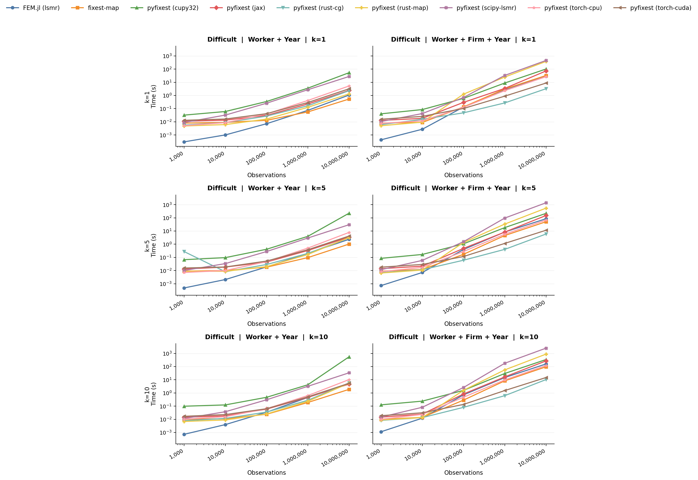
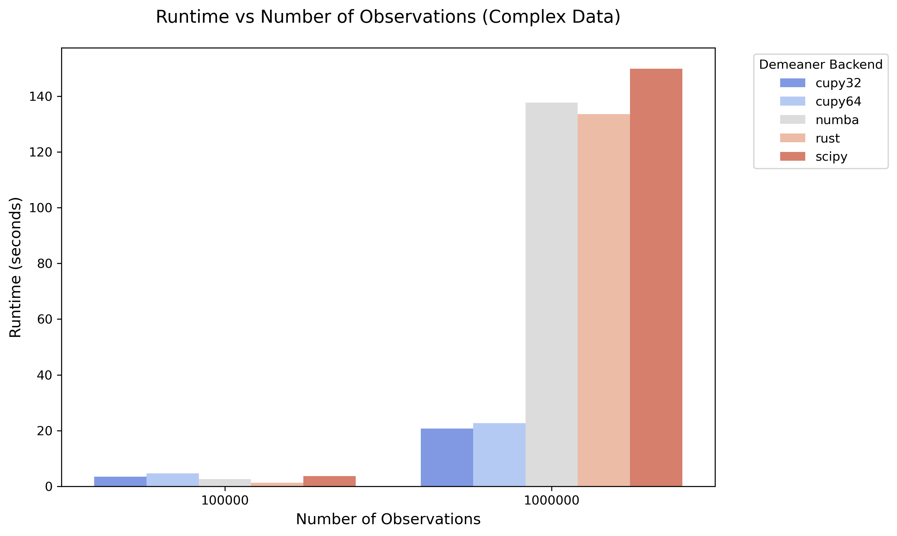

# Changelog

```{python}
import pyfixest as pf
from pyfixest.report.utils import rename_categoricals

df = pf.get_data()

fit1 = pf.feols("Y ~ X1", data = df)
fit2 = pf.feols("Y ~ X1 + X2", data = df)
fit3 = pf.feols("Y ~ X1 + X2 | f1", data = df)
```

## PyFixest 0.70.0 (In Development)

### TL;DR

- **Varying slopes.** `| f1[X2]` estimates a separate slope on `X2` for each
  level of `f1`, in `feols()`, `fepois()` and `feglm()`.
- **Formulas are parsed by `formulaic`.** The fitted model spec is reused for
  `predict()` and `fixef()`, so new data is encoded exactly like the estimation
  data, and `predict(newdata=...)` now works with `i()`, `poly()` and
  interacted fixed effects. Along with it come new formula spellings:
  - Instrumental variables use bracket syntax, `Y ~ X1 + [X2 ~ Z1]`, which
    also accepts interacted endogenous terms such as `X2:Z2`
    ([#1890](https://github.com/py-econometrics/pyfixest/pull/1890)). The old
    `Y ~ X1 | X2 ~ Z1` syntax still works, but it emits a deprecation warning
    and will be removed in a future release.
  - Fixed-effect interactions are written `f1:f2`.
  - `sw()`, `csw()`, `sw0()` and `csw0()` accept a single argument, so
    `| sw0(f1)` fits models with and without `f1`
    ([#1830](https://github.com/py-econometrics/pyfixest/pull/1830)).
- **New default demeaner.** LSMR from the `within` package with an adaptive
  preconditioner.
- **Typed results.** Fitted models expose their state as documented components
  such as `fit.coeftable`, `fit.variance_covariance` and `fit.model`.
- **Also new:** anytime-valid inference (SAVI), Word tables from `etable()`,
  weights and offsets in `feglm()`, clustering on three or more variables, and
  Python 3.15.
- **Many correctness fixes**, several of which change results: `ritest()`
  p-values, `i()` reference levels, weighted RMSE, the IV first stage,
  `decompose()` and `quantreg`'s `cfm2` process. See [Bug fixes](#v0700-bug-fixes).
- **Before you upgrade:** pyfixest needs Python 3.11+ and newer formulaic and
  pandas; model names in multiple estimation changed; `fixef()` returns a
  DataFrame; most private attributes such as `fit._se` are gone; `f1^f2` and
  `Y ~ X1 | X2 ~ Z1` are deprecated. See [Breaking changes](#v0700-breaking-changes)
  and [Migrating Fitted-Model Attributes](/how-to/migrate-fit-attributes.qmd).

### New Features {#v0700-new-features}

#### Varying Slopes

`feols()` (including IV), `fepois()` and `feglm()` accept slopes that vary by
fixed-effect level. `f1[X2]` absorbs `f1` and a slope on `X2` for each of its
levels; `f1[[X2]]` absorbs only the slopes. Varying slopes need the default
`within` demeaner, and `predict()`, `fixef()`, `wildboottest()`, `ritest()`,
`decompose()`, `did2s()` and CRV3 or HAC inference don't support them yet
([#1932](https://github.com/py-econometrics/pyfixest/pull/1932), [#1999](https://github.com/py-econometrics/pyfixest/pull/1999)).

```{python}
pf.feols("Y ~ X1 | f1[X2] + f2", data=df).tidy()
```

#### Formulas Parsed by `formulaic`

We no longer split formula strings by hand. Formulas go to `formulaic`, and
the fitted `ModelSpec` is reused to build model matrices for `predict()` and
`fixef()`. This removes a class of bugs where new data was encoded differently
from the estimation data. Most terms now follow `formulaic`'s syntax
([#1427](https://github.com/py-econometrics/pyfixest/pull/1427)).

- `predict(newdata=...)` works with `i()`, `poly()` and interacted fixed
  effects. Unseen levels predict `NaN`.
- Instrumental variables use bracket syntax, `Y ~ X1 + [X2 ~ Z1]`, which also
  accepts interacted endogenous terms such as `X2:Z2` ([#1890](https://github.com/py-econometrics/pyfixest/pull/1890)).
- Fixed-effect interactions are written `f1:f2`.
- `sw()`, `csw()`, `sw0()` and `csw0()` accept a single argument, so
  `| sw0(f1)` fits models with and without `f1` ([#1830](https://github.com/py-econometrics/pyfixest/pull/1830)).

The old spellings still work with a deprecation warning and will be removed
in a future release. The behaviour changes
that come with the new parser are listed under
[Breaking changes](#v0700-breaking-changes).

#### `within` LSMR Is the Default Demeaner

The default demeaner is now LSMR from the
[`within`](https://github.com/py-econometrics/within) Python package
(`within-py`, a new required dependency), replacing the Rust crate compiled
into pyfixest. Rust MAP is still available through `MapDemeaner()`.

The default `preconditioner="auto"` now selects `within`'s adaptive
preconditioner. It starts with the cheap diagonal preconditioner and builds
additive Schwarz only when convergence stalls, which skips Schwarz's setup
cost on well-connected fixed effects where it rarely pays off. `fepois()` and
`feglm()` reuse the preconditioner across IRLS iterations ([#1920](https://github.com/py-econometrics/pyfixest/pull/1920), [#1922](https://github.com/py-econometrics/pyfixest/pull/1922),
[#1923](https://github.com/py-econometrics/pyfixest/pull/1923)).

#### Typed Fitted-Model State

Fitted models expose what they computed as documented components instead of
private attributes ([#1533](https://github.com/py-econometrics/pyfixest/pull/1533), [#2028](https://github.com/py-econometrics/pyfixest/pull/2028)):

| Component | Contents |
|---|---|
| `fit.model` | formula, dependent variable, fixed effects, estimator, sample split |
| `fit.options` | estimation options: `ssc`, weights, demeaner, storage settings |
| `fit.sample_info` | number of observations and dropped rows by reason |
| `fit.coeftable` | estimates, standard errors, t-statistics, p-values, confidence intervals |
| `fit.variance_covariance` | covariance matrix, small-sample corrections, cluster counts |
| `fit.sandwich` | scores, Hessian and bread |
| `fit.fitstat` | RMSE, R² measures, deviance, log-likelihoods |
| `fit.fitted_values` | in-sample predictions on the link and response scale |
| `fit.collinearity` | columns dropped as collinear |
| `fit.fixef_counts`, `fit.fixef_estimates` | fixed-effect level counts; fixed-effect estimates after `fixef()` |
| `fit.first_stage` | IV first stage and its diagnostics |
| `fit.wald` | result of the last `wald_test()` |
| `fit.capabilities` | inference and post-estimation methods the model supports |
| `fit.solution` | quantile-regression solver state |

The components that describe the model and its sample survive
`store_data=False` and `lean=True`.

#### Safe Anytime-Valid Inference (SAVI)

`evalue()`, `pvalue_savi()` and `confint(inference_type="savi")` return
e-values, sequential p-values and confidence sequences for linear regression,
following [Lindon et al. (2026)](https://doi.org/10.1080/01621459.2026.2692052)
([#1386](https://github.com/py-econometrics/pyfixest/pull/1386)).

```{python}
fit = pf.feols("Y ~ X1 + X2", data=df, vcov="iid")
fit.confint(inference_type="savi")
```

#### Smaller Additions

- `etable(type="docx")` returns or saves editable Word tables, styled through
  `docx_style` ([#1541](https://github.com/py-econometrics/pyfixest/pull/1541)).
- `feglm()` accepts `weights`, `weights_type`, `offset` and
  `family="poisson"`. Offsets can be expressions such as
  `offset="log(exposure)"` ([#1353](https://github.com/py-econometrics/pyfixest/pull/1353), [#1458](https://github.com/py-econometrics/pyfixest/pull/1458)).
- `fepois()` converges faster thanks to step-halving and warm starts
  ([#1353](https://github.com/py-econometrics/pyfixest/pull/1353)).
- Cluster-robust inference accepts three or more cluster variables, e.g.
  `vcov={"CRV1": "firm + year + region"}` ([#1599](https://github.com/py-econometrics/pyfixest/pull/1599)).
- `tidy()`, `confint()` and `summary()` gain an `inference_type` argument.
  `confint(inference_type="simult")` replaces `confint(joint=True)`
  ([#1398](https://github.com/py-econometrics/pyfixest/pull/1398)).
- Python 3.15 is supported. On 3.15, plots use matplotlib because `lets-plot`
  has no compatible release yet ([#2030](https://github.com/py-econometrics/pyfixest/pull/2030)).

### Breaking Changes {#v0700-breaking-changes}

#### Requirements

- Python 3.11 or newer ([#2029](https://github.com/py-econometrics/pyfixest/pull/2029)).
- `formulaic>=1.2.2,<1.3`, `pandas>=2.3.3`, `narwhals>=1.17` and the new
  `within-py>=0.4,<0.5` ([#1899](https://github.com/py-econometrics/pyfixest/pull/1899), [#1954](https://github.com/py-econometrics/pyfixest/pull/1954), [#1920](https://github.com/py-econometrics/pyfixest/pull/1920)).

#### Formulas and Model Names

- Model names in multiple estimation are canonical formulas.
  `"Y ~ sw(X2+X1, X1)"` now names its models `"Y ~ 1 + X2 + X1"` and
  `"Y ~ 1 + X1"`. Update `rename_models` mappings and lookups into
  `all_fitted_models`. Expansions that produce the same model twice estimate
  it once and warn ([#1427](https://github.com/py-econometrics/pyfixest/pull/1427), [#1873](https://github.com/py-econometrics/pyfixest/pull/1873), [#1890](https://github.com/py-econometrics/pyfixest/pull/1890)).
- `fixef()` returns a DataFrame with columns `variable`, `code`, `level` and
  `coefficient` instead of a nested dict ([#1427](https://github.com/py-econometrics/pyfixest/pull/1427)).
- The main formula sets the intercept for both IV stages; a `0` or `1` inside
  the IV block is ignored ([#1998](https://github.com/py-econometrics/pyfixest/pull/1998)).
- Fixed effects must be data columns, or `:` interactions of them, whose names
  are valid Python identifiers. Transforms and `object`-dtype columns are
  rejected, and `predict()` requires the same dtype as at fit time ([#1899](https://github.com/py-econometrics/pyfixest/pull/1899)).
- `log()` in formulas is now `np.log`. Zeros are counted as infinite rather
  than missing, and numpy warns on zero or negative inputs. Estimates are
  unchanged ([#1806](https://github.com/py-econometrics/pyfixest/issues/1806), [#1869](https://github.com/py-econometrics/pyfixest/pull/1869)).
- Some malformed formulas raise `formulaic.errors.FormulaSyntaxError`, which is
  unrelated to `pyfixest.errors.FormulaSyntaxError`; catch both ([#1427](https://github.com/py-econometrics/pyfixest/pull/1427)).
- `factor_interaction` moved to
  `pyfixest.estimation.formula.transforms.factor_interaction` ([#1427](https://github.com/py-econometrics/pyfixest/pull/1427)).

#### Fitted Models and Post-Estimation

- Most private attributes from 0.60 are removed. Accessing one, e.g.
  `fit._se`, raises an error that names its replacement (`fit.coeftable.se`).
  Names used by released versions of marginaleffects and maketables, and the
  IV attributes `_model_1st_stage`, `_f_stat_1st_stage` and `_eff_F`, keep
  working. See [Migrating Fitted-Model Attributes](/how-to/migrate-fit-attributes.qmd)
  ([#2028](https://github.com/py-econometrics/pyfixest/pull/2028)).
- `pf.ssc()` returns a frozen `Ssc` instead of a dict (dicts are still accepted
  as input), and `wald_test()` returns a `WaldTest` instead of a Series
  ([#1595](https://github.com/py-econometrics/pyfixest/pull/1595), [#1591](https://github.com/py-econometrics/pyfixest/pull/1591)).
- `feglm().resid()` returns response residuals `y - mu` by default; the old
  working residuals are `resid(type="working")` ([#1496](https://github.com/py-econometrics/pyfixest/pull/1496)).
- `feglm(family="gaussian")` now reproduces `feols()` exactly, including its
  small-sample correction ([#1353](https://github.com/py-econometrics/pyfixest/pull/1353)).
- Passing `data` to `vcov()` raises `ValueError`. It silently misaligned rows
  in cluster-robust standard errors ([#1825](https://github.com/py-econometrics/pyfixest/issues/1825), [#1956](https://github.com/py-econometrics/pyfixest/pull/1956)).
- `vcov` and `vcov_kwargs` are checked before fitting, so a misspelled
  estimator or a missing cluster column fails early with `ValueError`
  ([#1577](https://github.com/py-econometrics/pyfixest/pull/1577)).
- Several methods that ran on unsupported models and returned wrong numbers
  now raise: `ccv()` on weighted models; `Feols.update()` with `inplace=True`,
  weights or IV; CRV3 on non-Poisson GLMs; `ritest()` on models other than OLS
  and Poisson; `wildboottest()` on IV and non-OLS models; `decompose()` on
  non-`feols` models or with multiway clustering; `predict()`,
  `wildboottest()`, `ccv()`, `decompose()` and `vcov()` updates on `did2s()`
  fits; and `predict(se_fit=True)` for GLMs and quantile regression ([#1516](https://github.com/py-econometrics/pyfixest/pull/1516),
  [#1620](https://github.com/py-econometrics/pyfixest/pull/1620), [#1726](https://github.com/py-econometrics/pyfixest/pull/1726), [#1698](https://github.com/py-econometrics/pyfixest/pull/1698), [#1652](https://github.com/py-econometrics/pyfixest/issues/1652), [#1983](https://github.com/py-econometrics/pyfixest/pull/1983)).
- Invalid arguments to `ccv()`, `ritest()`, `event_study()`, `did2s()` and
  `lpdid()` raise `ValueError` or `TypeError` instead of `AssertionError`
  ([#1723](https://github.com/py-econometrics/pyfixest/pull/1723)). Every warning now has an explicit category and points at your
  code rather than pyfixest internals ([#1723](https://github.com/py-econometrics/pyfixest/pull/1723)).
- Methods that need data removed by `store_data=False` or `lean=True` raise
  `MissingModelDataError` ([#1540](https://github.com/py-econometrics/pyfixest/pull/1540)).
- pyfixest no longer uses or reseeds NumPy's global random generator. Data from
  `get_blw()`, `get_sharkfin()` and `get_panel_dgp_stagg()` changes, and
  `ccv()` and simultaneous confidence intervals need `seed=` to be
  reproducible ([#1705](https://github.com/py-econometrics/pyfixest/pull/1705)).
- The model classes take `options=` and `sample_split=` constructor arguments
  instead of many loose keyword arguments ([#1598](https://github.com/py-econometrics/pyfixest/pull/1598), [#1719](https://github.com/py-econometrics/pyfixest/pull/1719)).

#### Demeaner

- `preconditioner="auto"` now means adaptive, so results can differ slightly
  from 0.60. Pass `preconditioner="additive"` for the old behaviour ([#1922](https://github.com/py-econometrics/pyfixest/pull/1922)).
- `pf.Preconditioner` is `within.Preconditioner`. Its `variant` is replaced by
  `config`, and `build_time_seconds` is renamed `build_duration_seconds`.
  Preconditioners pickled with older versions can't be loaded ([#1920](https://github.com/py-econometrics/pyfixest/pull/1920)).

#### Deprecated

These still work and emit a warning ([#1427](https://github.com/py-econometrics/pyfixest/pull/1427), [#1398](https://github.com/py-econometrics/pyfixest/pull/1398), [#1704](https://github.com/py-econometrics/pyfixest/pull/1704)):

- `Y ~ X1 | f1^f2`: write `Y ~ X1 | f1:f2`.
- `Y ~ X1 | X2 ~ Z1`: write `Y ~ X1 + [X2 ~ Z1]`.
- `Y + Y2 ~ X1`: write `sw(Y, Y2) ~ X1`.
- `confint(joint=True)`: use `confint(inference_type="simult")`.
- `FixestMulti.FixestFormulaDict`: use `fit.model.parsed_formula`.

#### Removed

- The `demeaner_backend`, `fixef_tol` and `fixef_maxiter` arguments; use the
  `Demeaner` API from 0.60 ([#1353](https://github.com/py-econometrics/pyfixest/pull/1353)).
- The JAX demeaner and solver, and the SciPy and CuPy LSMR backends. On GPU,
  use `LsmrDemeaner(backend="torch", device="cuda")` ([#1353](https://github.com/py-econometrics/pyfixest/pull/1353), [#1718](https://github.com/py-econometrics/pyfixest/pull/1718)).
- `FeolsCompressed` and `pf.dtable()`; use `maketables.DTable()` instead ([#1404](https://github.com/py-econometrics/pyfixest/pull/1404)).
- `FixestFormulaParser`, `model_matrix_fixest()`, the
  `pyfixest.estimation.feols_`, `feiv_` and `fepois_` modules (import from
  `pyfixest` instead), and several unused helpers in `pyfixest.utils`
  ([#1607](https://github.com/py-econometrics/pyfixest/pull/1607), [#1704](https://github.com/py-econometrics/pyfixest/pull/1704)).

### Bug Fixes {#v0700-bug-fixes}

#### Inference

- `ritest()` now permutes the observed treatment. It used to draw treatments
  uniformly from the distinct values, which changed the share treated and
  typically made p-values too small. This also affects `rwolf()` and `wyoung()`
  with `sampling_method="ri"` ([#1964](https://github.com/py-econometrics/pyfixest/issues/1964), [#1965](https://github.com/py-econometrics/pyfixest/pull/1965)).
- `ritest(type="randomization-t")`, `ritest(cluster=...)` and `ccv()` keep the
  fitted model's covariance estimator and small-sample corrections, and the
  randomization t-statistic is centred at the null ([#1960](https://github.com/py-econometrics/pyfixest/issues/1960), [#1986](https://github.com/py-econometrics/pyfixest/pull/1986)–[#1989](https://github.com/py-econometrics/pyfixest/pull/1989)).
- `ritest()` rebuilds treatment-dependent interactions on every draw ([#1979](https://github.com/py-econometrics/pyfixest/pull/1979)),
  and its fast algorithm works with interacted fixed effects ([#1780](https://github.com/py-econometrics/pyfixest/issues/1780),
  [#1898](https://github.com/py-econometrics/pyfixest/pull/1898)).
- `vcov({"CRV3": ...})`, `ritest()` and `ccv()` refit with all the original
  estimation options. Before, a Poisson `offset` and options such as
  `context` or `drop_intercept` were dropped ([#1709](https://github.com/py-econometrics/pyfixest/pull/1709), [#1711](https://github.com/py-econometrics/pyfixest/pull/1711)).
- CRV3 on `event_study()` fits refits with `feols()` instead of Poisson
  ([#1619](https://github.com/py-econometrics/pyfixest/pull/1619)).
- `wildboottest()` and `decompose()` leave out covariates that the fit dropped
  as collinear ([#1778](https://github.com/py-econometrics/pyfixest/issues/1778), [#1867](https://github.com/py-econometrics/pyfixest/pull/1867)), and `wildboottest()` requires `param`
  instead of returning p = 0 ([#1959](https://github.com/py-econometrics/pyfixest/issues/1959), [#1969](https://github.com/py-econometrics/pyfixest/pull/1969)).
- `confint()` with `keep` or `drop` could attach intervals to the wrong
  coefficients ([#1397](https://github.com/py-econometrics/pyfixest/pull/1397)).
- The RMSE of weighted fits divides by the sum of weights ([#1883](https://github.com/py-econometrics/pyfixest/issues/1883), [#1884](https://github.com/py-econometrics/pyfixest/pull/1884)).

#### IV

- The first stage uses the second stage's sample, options and full covariance
  estimator. Before, two-way clustering fell back to one-way clustering, and
  `vcov="NW"` or `"DK"` failed ([#1710](https://github.com/py-econometrics/pyfixest/pull/1710)).
- Redundant instruments no longer change the first-stage F or effective F
  ([#1996](https://github.com/py-econometrics/pyfixest/pull/1996)). Instruments that don't identify an endogenous variable raise
  `IVIdentificationError` ([#1891](https://github.com/py-econometrics/pyfixest/issues/1891), [#1993](https://github.com/py-econometrics/pyfixest/pull/1993)).
- Covariates named like generated values (`X2_hat`), misplaced IV blocks, and
  `|` inside IV expressions are handled correctly ([#1736](https://github.com/py-econometrics/pyfixest/issues/1736), [#1808](https://github.com/py-econometrics/pyfixest/issues/1808), [#1766](https://github.com/py-econometrics/pyfixest/issues/1766),
  [#1890](https://github.com/py-econometrics/pyfixest/pull/1890), [#1834](https://github.com/py-econometrics/pyfixest/pull/1834)).

#### Formulas

- Multiple estimation no longer reuses demeaned values from a different
  expression that happens to have the same column name ([#1762](https://github.com/py-econometrics/pyfixest/issues/1762), [#1914](https://github.com/py-econometrics/pyfixest/pull/1914)).
- `i()` fixes:
  - a boolean second variable fits one slope per level ([#1756](https://github.com/py-econometrics/pyfixest/issues/1756), [#1907](https://github.com/py-econometrics/pyfixest/pull/1907));
  - levels come from the data before missing rows are dropped, and unused
    categories of a `Categorical` are ignored, which fixes the reference level
    in some models ([#1769](https://github.com/py-econometrics/pyfixest/issues/1769), [#1912](https://github.com/py-econometrics/pyfixest/pull/1912));
  - without an intercept, every interaction cell is kept ([#1767](https://github.com/py-econometrics/pyfixest/issues/1767), [#1942](https://github.com/py-econometrics/pyfixest/pull/1942));
  - `C(k)` marks a numeric second variable as a factor, so `i(a, C(k))`
    interacts two factors instead of fitting slopes. `ref2` and `bin2` no
    longer turn a numeric second variable into a factor and raise instead
    ([#1770](https://github.com/py-econometrics/pyfixest/issues/1770),
    [#1804](https://github.com/py-econometrics/pyfixest/issues/1804),
    [#1943](https://github.com/py-econometrics/pyfixest/pull/1943));
  - `bin` is validated ([#1771](https://github.com/py-econometrics/pyfixest/issues/1771), [#1945](https://github.com/py-econometrics/pyfixest/pull/1945));
  - factor-by-factor interactions work with NumPy 1.25 ([#1909](https://github.com/py-econometrics/pyfixest/issues/1909), [#1952](https://github.com/py-econometrics/pyfixest/pull/1952)).
- Formulas whose terms produce duplicate column names raise instead of keeping
  only the last column ([#1928](https://github.com/py-econometrics/pyfixest/issues/1928), [#1947](https://github.com/py-econometrics/pyfixest/pull/1947)).
- `sw()` and friends work across several lines and with a space before the
  parenthesis ([#1810](https://github.com/py-econometrics/pyfixest/issues/1810), [#1847](https://github.com/py-econometrics/pyfixest/pull/1847)). Stepwise terms keep their grouping under
  `:`, `*` and `-` ([#1828](https://github.com/py-econometrics/pyfixest/pull/1828)).
- `log()` accepts nullable `Float64` and `Int64` columns ([#1807](https://github.com/py-econometrics/pyfixest/issues/1807), [#1829](https://github.com/py-econometrics/pyfixest/pull/1829)).
- `weights=` accepts column names with spaces or operators ([#1815](https://github.com/py-econometrics/pyfixest/issues/1815),
  [#1844](https://github.com/py-econometrics/pyfixest/pull/1844)). Zero weights are dropped with a warning instead of raising
  ([#1800](https://github.com/py-econometrics/pyfixest/issues/1800), [#1864](https://github.com/py-econometrics/pyfixest/pull/1864)).

#### GLM and Poisson

- Frequency weights work in `fepois()` and `feglm()` ([#1521](https://github.com/py-econometrics/pyfixest/pull/1521)).
- Separation checks: Gaussian `feglm()` no longer drops groups as separated
  ([#1978](https://github.com/py-econometrics/pyfixest/issues/1978), [#1982](https://github.com/py-econometrics/pyfixest/pull/1982)); logit and probit also drop groups whose outcomes are all
  1, and ignore `separation_check=["ir"]` with a warning ([#1623](https://github.com/py-econometrics/pyfixest/issues/1623), [#1982](https://github.com/py-econometrics/pyfixest/pull/1982));
  the iterative-rectifier check keeps rows aligned after missing values and
  respects the formula context and demeaner ([#1777](https://github.com/py-econometrics/pyfixest/issues/1777), [#1799](https://github.com/py-econometrics/pyfixest/issues/1799), [#1846](https://github.com/py-econometrics/pyfixest/pull/1846),
  [#1841](https://github.com/py-econometrics/pyfixest/pull/1841), [#1877](https://github.com/py-econometrics/pyfixest/pull/1877), [#1454](https://github.com/py-econometrics/pyfixest/pull/1454)).
- `fixef()` and `predict()` for fixed-effects-only GLMs work on the link scale
  instead of the response scale ([#1622](https://github.com/py-econometrics/pyfixest/pull/1622)).
- `fepois(context=0)` finds functions defined in your code ([#1656](https://github.com/py-econometrics/pyfixest/issues/1656), [#1835](https://github.com/py-econometrics/pyfixest/pull/1835)).
- `fixef()`, `predict()`, `decompose()` and the LSQR solver raise
  `NonConvergenceError` instead of returning unconverged estimates ([#2009](https://github.com/py-econometrics/pyfixest/pull/2009),
  [#2012](https://github.com/py-econometrics/pyfixest/pull/2012)).

#### DiD and Decomposition

- `did2s()` standard errors use the first-stage fixed-effect encoding, handle
  collinear second-stage columns, and require at least two non-missing
  clusters ([#1758](https://github.com/py-econometrics/pyfixest/issues/1758), [#1811](https://github.com/py-econometrics/pyfixest/issues/1811), [#1812](https://github.com/py-econometrics/pyfixest/issues/1812), [#1918](https://github.com/py-econometrics/pyfixest/pull/1918), [#1865](https://github.com/py-econometrics/pyfixest/pull/1865), [#1980](https://github.com/py-econometrics/pyfixest/pull/1980)). It also
  explains which first-stage fixed effects can't be estimated ([#1244](https://github.com/py-econometrics/pyfixest/issues/1244),
  [#1368](https://github.com/py-econometrics/pyfixest/pull/1368)).
- `event_study(estimator="saturated")` uses the `xfml` covariates, which it
  used to ignore ([#1966](https://github.com/py-econometrics/pyfixest/issues/1966), [#1975](https://github.com/py-econometrics/pyfixest/pull/1975)).
- `decompose()` no longer depends on the order of regressors ([#1967](https://github.com/py-econometrics/pyfixest/issues/1967),
  [#1974](https://github.com/py-econometrics/pyfixest/pull/1974)), keeps mediators left out of `combine_covariates` in an `Other`
  group ([#1962](https://github.com/py-econometrics/pyfixest/issues/1962), [#1972](https://github.com/py-econometrics/pyfixest/pull/1972)), and draws independent bootstrap samples in
  parallel, so `seed` gives the same result for any `nthreads` ([#1696](https://github.com/py-econometrics/pyfixest/pull/1696)).

#### Other

- `quantreg(multi_method="cfm2")` uses the density-weighted Hessian. Before,
  the updates mostly shifted the intercept ([#1745](https://github.com/py-econometrics/pyfixest/issues/1745), [#1842](https://github.com/py-econometrics/pyfixest/pull/1842)).
- `LsmrDemeaner(backend="torch")` raises `ImportError` when PyTorch is missing
  instead of silently using MAP ([#1718](https://github.com/py-econometrics/pyfixest/pull/1718)).
- `iplot()` no longer mistakes regressors with `::` in their name for `i()`
  terms ([#1564](https://github.com/py-econometrics/pyfixest/pull/1564)).
- Importing pyfixest no longer loads the plotting libraries ([#1483](https://github.com/py-econometrics/pyfixest/pull/1483)).

### Documentation

- Tutorials, the README and docstrings use the new formula spellings, and the
  formula tutorial maps each deprecated form to its replacement ([#1836](https://github.com/py-econometrics/pyfixest/pull/1836)).

### Contributor Workflow

- New pixi tasks: `bench-estimation` for before/after timing,
  `test-r-fixest-fast` for a quick comparison with R, and
  `test-release-contract` for a comparison with pyfixest 0.60.0 ([#1732](https://github.com/py-econometrics/pyfixest/pull/1732),
  [#1476](https://github.com/py-econometrics/pyfixest/pull/1476)).
- Only the default demeaner is tested against `fixest` in the main test suite;
  the other backends run in a separate workflow ([#1485](https://github.com/py-econometrics/pyfixest/pull/1485)).
- Repository-local skills and developer guides for contributors and coding
  agents ([#1476](https://github.com/py-econometrics/pyfixest/pull/1476)).
- `pixi.lock` uses the v7 format, which needs pixi 0.71.0 or newer ([#1498](https://github.com/py-econometrics/pyfixest/pull/1498)).
- Internals: fitted models keep the formula `ModelMatrix`, the demeaning cache
  hands out read-only `float64` arrays, and weighting happens inside the
  solver instead of on stored arrays ([#1499](https://github.com/py-econometrics/pyfixest/pull/1499), [#1914](https://github.com/py-econometrics/pyfixest/pull/1914), [#1520](https://github.com/py-econometrics/pyfixest/pull/1520)).

## PyFixest 0.60.0

This release focuses on the fixed-effects demeaning stack. The main changes are
a typed demeaner API, switching from `numba` to Rust for the default MAP demeaning algorithm, reusable `within` preconditioners,
PyTorch-backed LSMR demeaning on CPU and GPU, and a few deprecations for older
backend options. It also adds `fepois()` offsets, Typst output for `etable()`,
and several `panelview()` fixes.

### Rust MAP Default and Optional Numba

`MapDemeaner()` now defaults to `backend="rust"`. The Numba MAP backend remains
available via `MapDemeaner(backend="numba")`, and the fast randomization-inference
path (`fit.ritest(..., choose_algorithm="fast")`) still uses Numba. Numba is now
an optional dependency installed with `pip install pyfixest[numba]`.

### Typed Demeaner API

A new typed demeaner API replaces the old `demeaner_backend`, `fixef_tol`, and
`fixef_maxiter` arguments to `feols()`, `fepois()`, and related functions.
Instead of passing a set of loosely related keyword arguments, you can now pass a
configuration object that makes the chosen algorithm, tolerance, iteration limit,
and device explicit.

```python
import pyfixest as pf
from pyfixest.demeaners import MapDemeaner, LsmrDemeaner

# Old API (deprecated)
fit = pf.feols("Y ~ X1 | f1", data=df, demeaner_backend="rust", fixef_tol=1e-8, fixef_maxiter=5000)

# New API
fit = pf.feols("Y ~ X1 | f1", data=df, demeaner=MapDemeaner(backend="rust", fixef_tol=1e-8, fixef_maxiter=5000))
fit = pf.feols("Y ~ X1 | f1", data=df, demeaner=LsmrDemeaner(backend="within", fixef_atol=1e-8, fixef_btol=1e-8, fixef_maxiter=5000))
fit = pf.feols("Y ~ X1 | f1", data=df, demeaner=LsmrDemeaner(backend="torch", device="cuda"))
```

**Deprecations:** The `demeaner_backend`, `fixef_tol`, and `fixef_maxiter`
arguments to `feols()` and related functions are deprecated and will be removed
in a future release. The `_fixef_tol` and `_fixef_maxiter` attributes on fitted
model objects are removed; going forward, this information is collected from the
typed `fit.options.demeaner` via `fit.options.demeaner.fixef_tol` and
`fit.options.demeaner.fixef_maxiter`.

**Default change:** `LsmrDemeaner()` now defaults to `fixef_maxiter=1_000`
(previously inherited `10_000` from `BaseDemeaner`). LSMR typically converges in
far fewer than 1,000 iterations, but if you hit `"Demeaning failed after 1000
iterations"` on a difficult problem, pass `LsmrDemeaner(fixef_maxiter=10_000)`
(or higher) explicitly.

The lower-level `pyfixest.core.demean.demean_within(...)` helper also tightened
its default `tol` from `1e-6` to `1e-8`. Calls through `LsmrDemeaner` already
pass `max(fixef_atol, fixef_btol)` (default `1e-8`), so the new default matches
what the typed API was already using. Only direct callers of
`demean_within(...)` with no `tol` argument see a behaviour change.

### Diagonal Preconditioner for the `within` LSMR Backend

PyFixest now bundles version 0.2.0 of the `within` Rust solver, which adds a
diagonal (Jacobi) preconditioner. You can use it with
`LsmrDemeaner(backend="within", preconditioner="diagonal")`, alongside the
existing `"additive"` (default) and `"off"` options.


### Reusing Preconditioners

The `within` LSMR backend now exposes its additive Schwarz preconditioner so the
(potentially) expensive setup phase can be amortised when users explicitly reuse
it across regressions based on the same fixed-effect design.

```python
import pyfixest as pf
from pyfixest.demeaners import LsmrDemeaner

df = pf.get_data()

# Every Feols-family fit exposes the preconditioner that was used.
fit = pf.feols("Y ~ X1 | f1 + f2", data=df, demeaner=LsmrDemeaner())
pre = fit.preconditioner

# Pass it back via `LsmrDemeaner(preconditioner=...)` to skip the setup
# phase on a later fit over the same design.
fit_fast = pf.feols(
    "Y ~ X1 + X2 | f1 + f2",
    data=df,
    demeaner=LsmrDemeaner(preconditioner=pre),
)
```

For `fepois()` and `feglm()`, the first IWLS iteration builds the
preconditioner and every subsequent iteration reuses it under the changing
working weights. That means the reused preconditioner is "stale" because it was
built under the initial iteration's weights. LSMR still converges to the correct
demeaned values, but it may take a few extra iterations per IWLS step. The setup
phase is paid once instead of once per IWLS iteration.

Each `Preconditioner` also reports its original setup time via
`preconditioner.build_time_seconds`, which can be useful when profiling large
fixed-effect problems. `Preconditioner` instances are pickleable, so the setup
phase can also be amortised across Python sessions. See
[Choosing a Demeaner Backend](how-to/demeaner-backends.qmd) for details.

### PyTorch LSMR Backend

PyFixest now includes an experimental PyTorch-backed LSMR demeaner. It supports
CPU execution, CUDA GPUs, and Apple Silicon MPS:

```python
fit = pf.feols(
    "Y ~ X1 | f1 + f2",
    data=df,
    demeaner=pf.LsmrDemeaner(backend="torch", device="cuda"),
)
```

Install the optional dependency with `pip install pyfixest[torch]`. For CUDA,
you may need to install a CUDA-enabled PyTorch build separately, following the
PyTorch installation instructions.

### JAX, CuPy, and SciPy Backend Deprecations

The `jax` MAP demeaner backend, the `cupy` / `scipy` LSMR demeaner backends, and
the `solver="jax"` OLS solver option are deprecated and will be removed in a
future release. Passing any of them now raises a `DeprecationWarning`.

We recommend the following replacements:

- **JAX MAP on CPU** → `MapDemeaner()` (the default rust MAP).
- **JAX MAP on GPU** or **`LsmrDemeaner(backend="cupy", device="cuda")`** → `LsmrDemeaner(backend="torch", device="cuda")`.
- **Scipy or Cupy LSMR on CPU** → `LsmrDemeaner()` (the default `within` backend).

### Regression Compression Deprecation

The `use_compression` argument to `feols()` is deprecated and no longer
supported. This feature implemented the in-memory regression compression
approach from [Wong et al. (2021)](https://arxiv.org/abs/2102.11297) via a
Mundlak/sufficient-statistics transform, and the implementation has now been
removed. For large-dataset use cases, the
[`duckreg`](https://github.com/py-econometrics/duckreg) package provides a more
general out-of-memory solution. See
[#1302](https://github.com/py-econometrics/pyfixest/issues/1302) for context.

Passing `use_compression=True` now raises a `NotImplementedError`.

### Offsets in `fepois()`

`pf.fepois()` now supports offsets via the new `offset` argument. This is useful
for Poisson models with an exposure term, such as `offset="log_population"`.
Thanks to @bradhackinen and @marie-gar for the contribution.

### `etable()` Typst Output and Formatting

`pf.etable()` now supports `type="typst"` output. Its default `coef_fmt` is also
inherited from `maketables`, which keeps PyFixest closer to the table engine it
uses internally. As before, significance stars are controlled by the coefficient
format string: include `*` on a statistic token, for example `b:.3f*`, when you
want stars in the rendered table.

### panelview Bug Fixes

- Validates that the `treat` column is binary (`{0, 1, True, False}`) and normalizes it to boolean before plotting, matching R's `panelView` behavior. See [#1311](https://github.com/py-econometrics/pyfixest/issues/1311).
- Fixes `sort_by_timing` to sort units by the period of first treatment (via `argmax`) rather than by the total number of treated periods.
- Raises an explicit `ValueError` when the `treat` column contains missing values instead of silently dropping them.
- Fixes a latent bug in `_plot_panelview` where passing a user-supplied `ax` together with `legend=True` referenced an unbound figure variable; the colorbar is now attached via `ax.figure`.

## PyFixest 0.50.1

### Bug Fixes

- Fixes an import-time failure on Python 3.13 in some environments where a `narwhals` typing alias was exposed as a string at runtime. This could cause imports of `feols()` / `feglm()` to fail before any model code ran. See [#1263](https://github.com/py-econometrics/pyfixest/issues/1263) for details.
- Clarifies `pf.etable()` significance-star behavior after the migration to `maketables`: stars are rendered only when `coef_fmt` includes `*` on a statistic token, for example `b*` or `b:.3f*`.

## PyFixest 0.50.0

::: {.callout-tip}
You can install the latest pre-release to try out the new features:

```{.bash .code-copy}
pip install pyfixest==0.50.0a2
pip install --pre pyfixest
```
:::

### New Demeaner Backend via the `within` package

We recently came together for a PyFixest sprint with the team from AppliedAI, and one new feature that already made it's way into the code base is a new typed demeaner configuration that performs really well for sparse fixed effects structures.

The new solver is exposed via `pf.LsmrDemeaner(backend="within")` and is a significant performance improvement for sparse fixed effects structures - such as matched employer-employee data, patient-doctor panels, or trade networks - where the standard MAP algorithm might struggle. On well-connected graphs, `pf.MapDemeaner(backend="rust")` remains competitive, but on sparse graphs the within-based solver is dramatically faster.

{width=85% fig-align="center"}

*Benchmark on a sparse fixed effects structure: vanilla MAP degrades dramatically, while `within` LSMR via `pf.LsmrDemeaner()` remains fast.*

For a detailed explanation of why some fixed effects problems are harder than others and comprehensive benchmarks, see [When Are Fixed Effects Estimations Difficult?](explanation/difficult-fixed-effects.md).

The new backend can also be accessed via standalone [Python](https://pypi.org/project/within-py/) and [Rust](https://crates.io/crates/within) packages that are available on PyPI and crates.io (see also the [GitHub repo](https://github.com/py-econometrics/within)).

Special shoutout to [Kristof](https://github.com/schroedk) from the [appliedAI Institute](https://www.appliedai-institute.de/en/) who developed and implemented the new algorithm.


### Reworked Formula Parsing and New `i()` Operator

The formula parsing module has been significantly reworked. The new implementation introduces a cleaner `Formula` class,
a rewritten `i()` operator that closely follows R's `fixest` syntax, and new multiple estimation operators.

#### New `i()` operator

The `i()` operator now follows the `fixest` naming convention, using `::` to separate variable names from levels. It further
provides two new arguments: `ref2` and `bin2` that allow to set
reference levels for interacted variables and to bin categoricals.

**Simple categorical encoding:**

```{python}
# Coefficient per level, first level dropped when intercept is present
fit = pf.feols("Y ~ i(f1, ref=1)", data=df)
fit.coef().head()
```

**Factor x Continuous interaction:**

```{python}
# Each level of f1 gets its own slope on X1
fit = pf.feols("Y ~ i(f1, X1, ref=1)", data=df)
fit.coef().head()
```

**Factor x Factor interaction** with `ref2`:

The `ref2` argument controls the reference level of the second variable in a factor-by-factor interaction.

```{python}
import numpy as np
df["group"] = np.where(df["f1"] < 15, "A", "B")

# Full interaction: f1 levels x group levels
# ref drops from f1, ref2 drops from group
fit = pf.feols("Y ~ i(f1, group, ref=1, ref2='A')", data=df)
fit.coef().head()
```

**Binning** with `bin` and `bin2`:

The `bin` parameter merges categorical levels before encoding. This is useful for collapsing sparse categories.
Values not in the mapping are kept unchanged, matching R `fixest` behavior.

```{python}
df["size"] = np.where(df["f1"] < 10, "small", np.where(df["f1"] < 20, "medium", "large"))

# Merge 'small' and 'medium' into 'not_large', then use as reference
fit = pf.feols("Y ~ i(size, bin={'not_large': ['small','medium']}, ref='not_large')", data=df)
fit.coef()
```

`bin2` applies binning to the second variable in a factor-by-factor interaction.

#### `mvsw()` and multiple estimation


`mvsw()` for **multiverse stepwise** — generates all $2^k$ combinations of the provided variables, including the intercept-only model.

```{python}
# mvsw: all combinations of X1 and X2
fits = pf.feols("Y ~ mvsw(X1, X2)", data=df)
pf.etable(fits)
```

Multiple estimation operators can be combined:

```{python}
# mvsw: all combinations of X1 and X2
fits = pf.feols("Y ~ sw(X1, X2) + csw(f1,f2)", data=df)
pf.etable(fits)
```

Last, you can run operations within the operators:

```{python}
# mvsw: all combinations of X1 and X2
fits = pf.feols("Y ~ sw(X1, f1 + X2)", data=df)
pf.etable(fits)
```

#### Deprecations

- `FixestFormulaParser` is deprecated in favor of `Formula.parse()`. A `FutureWarning` is emitted when the old class is used.
- `model_matrix_fixest()` is deprecated in favor of `create_model_matrix()`.


### Migration to maketables

The table functionality in pyfixest now uses [maketables](https://py-econometrics.github.io/maketables/). `maketables` is a spin-off of
pyfixest internal functions, but supports more packages in the Python eco-system (e.g. `statsmodels` and `linearmorels`). Due to it's close
connection to `pyfixest`, the API of `pf.etable()` remains unchanged.
**Changes:**

- `pf.etable()` now uses `maketables.ETable` internally. The API remains unchanged for backward compatibility.
- Because the function is not at the core of `pyixest` functionality, we will deprecate `pf.dtable()`.
  A `FutureWarning` is now emitted. The function has been moved to `maketables` and can be used by calling `maketables.DTable()` directly.
- The same applies for `pf.make_table()`, which has been an internal utility function to create tables. An equivalent function now lives in
  `maketables.MTable()`.
- The `great_tables` dependency has been replaced with `maketables`.

**Migration guide:**

```python
# dtable migration
# Before:
pf.dtable(df, vars=["Y", "X1"])
# After:
import maketables
maketables.DTable(df, vars=["Y", "X1"])

# make_table migration
# Before:
pf.make_table(df, type="gt", caption="My Table")
# After:
import maketables
maketables.MTable(df, caption="My Table").make(type="gt")
```

### Other Changes

- Adds the following statistics to the `Fepois` class: `_loglik`, `_loglik_null`, `_pseudo_r2` for regression without weights.
- Set the default parameters for the MAP algorithm to a tolerance of `1e-06` and maximum number of iterations of `10_000`.
- Adds support for weights for poisson regression via `feopis()`.

### GLMs with High-Dimensional Fixed Effects

`feglm()` now supports high-dimensional fixed effects for logit, probit, and gaussian families! Fixed effects are specified after the `|` symbol, just like in `feols()` and `fepois()`.

```{python}
import numpy as np

data_glm = pf.get_data()
data_glm["Y"] = np.where(data_glm["Y"] > 0, 1, 0)

# Logit with fixed effects
fit_logit = pf.feglm("Y ~ X1 + X2 | f1", data=data_glm, family="logit")
fit_logit.summary()
```

Fixed effects estimation via demeaning produces identical point estimates as one-hot encoding the fixed effects via `C()`:

```{python}
# Compare FE demeaning vs one-hot encoding
fit_logit_onehot = pf.feglm("Y ~ X1 + X2 + C(f1)", data=data_glm, family="logit")

pf.etable([fit_logit, fit_logit_onehot])
```

Note that standard errors may differ between the two approaches due to different degrees of freedom adjustments.

All three GLM families (gaussian, logit, probit) support fixed effects:

```{python}
fit_gaussian = pf.feglm("Y ~ X1 + X2 | f1", data=data_glm, family="gaussian")
fit_probit = pf.feglm("Y ~ X1 + X2 | f1", data=data_glm, family="probit")

pf.etable([fit_gaussian, fit_logit, fit_probit])
```

## PyFixest 0.40.1

### Breaking Changes for compatibility with `fixest` 0.13

`fixest` 0.13 has recently been released to CRAN, with a range of breaking changes. We are following these in pyfixet 0.40.0.

- The default inference method is now always "iid". Before, both `fixest` and `pyfixest` would default to cluster by the first fixest effect
  in the presence of fixed effect.
- The arguments of the `pf.ssc()` functions have been renamed: `adj` becomes `k_adj`, `fixef_k` becomes `k_fixef`, `cluster_df` becomes `G_df`, and `cluster_adj` becomes `G_adj`.
  Backwards compatibility is ensured.
- `fixest` no longer applies the `G/(G-1)` small sample correction for heteroskedastic errors. The argument is now only relevant for cluster robust errors.
- If the `k_adj` arg is set to `True` with heteroskedastic errors, the applied small sample correction now is `N / (N-k)` and no longer `(N-1) / (N-df_k)`,
  as was previously the case and is still the case for iid and cluster robust errors.
- The `k_fixef` option `"nested"` has been renamed to `"nonnested"`.
- The `fixef_rm` argument is changed from default `"none"` to `"singleton"` for all estimation functions. This has no impact on point estimates, but might change inference due to a smaller number of
  observations in the degree of freedom correction.
- The multicollinearity default tolerance has been reduced from 1e-10 to 1e-09.
- The attribute `_dof_k` has been renamed to `_df_k`.

Other related changes:
- The arguments to adjust the small samples for the `wildboottest` methods have been renamed to `k_adj` and `G_adj`.

### Moved to `pixi.toml` and install from conda-forge

We have been using pixi as our package manager for a while and are moving from a `pyproject.toml` to using a `pixi.toml` for specifying dependencies.
We also install all package by default from the free and open source conda-forge. Because of some environment resolution challenges around an old version of
`rpy2`that we need for testing `pyfixest` against `fixest`, we temporarily have dropped support for the dev and docs environments for windows. A fix is
work in progress.

## New Features

### CuPy and SciPy Backends via LSMR

We add CuPy and SciPy Backend to run the demeaning algorithm on the GPU via the sparse LSMR solver. For problems
where the standard demeaner struggles to converge, this strategy can lead to significant speedups if paired with a GPU.



### HAC Standard Errors

We now support HAC standard errors! Thanks for Daman (https://github.com/damandhaliwal) for all his work (and coping with me with the PR, which took forever to get through).
We now support:

- time series HAC
- panel HAC
- panel DK

variance-covariance matrices.

For now, we assume that the time series column is consecutive and each entry has "time delta 1". Relaxation of this requirement are work in progress.

### `cat_template` argument for plotting functions

For easier encoding of categorical variables in relation to the `iplot()` and `coefplot()` functions, we add a new function argument, cat_template:

```{python}
fit_c = pf.feols(fml = "Y ~ i(X1, f1)", data = df)
fit_c.iplot(cat_template = "{variable}::{value}")
```

This is particularly useful for Difference-in-Differences and event studies. You can find an example use case in the DiD [vignette](https://pyfixest.org/difference-in-differences.html#one-shot-adoption-static-and-dynamic-specifications).

Going forward, we will deprecate the `rename_event_study_coefs` function, which is no longer needed (and did not work anyways).

### Updates to Gelbach Decomposition

We have reworked the Gelbach Decomposition method, with some breaking changes: by default, calling `Feols.decompose()` now returns a `GelbachDecomposition` instance - before, we'd return a `pd.DataFrame`. The `param` argument has been renamed to `decomp_var`, but is not yet deprecated.

The class now comes with new `tidy()` and `etable()` methods.

```{python}
from pyfixest.utils.dgps import gelbach_data
import numpy as np
import pyfixest as pf

# Generate test data using gelbach_data
data = gelbach_data(nobs=500)
data["w"] = np.random.rand(500)
fit = pf.feols("y ~ x1 + x21 + x22 + x23", data=data)
gb = fit.decompose(decomp_var = "x1", x1_vars = ["x21"],reps = 10, nthreads = 1)
print(type(gb))
```

It is now also possible to add background variables that are included in both the long and short regressions via the `x1_vars` function argument.

We can inspect results as a `pd.DataFrame`

```{python}
gb.tidy()
```

or produce a `GT` table:

```{python}
gb.etable(
    stats = "all",
    caption = "Gelbach Decomposition"
)
```

As can be seen, we by default now return normalized (and not just absolute) effects.

We are now also supporting frequency weights for the decomposition (currently without inference).

Additionally, some house keeping and interal refactoring of the `GelbachDecomposition` class.

## PyFixest 0.30.0

### New Features

- We have created a **Rust** backend for all performance critical algorithms, with pretty great performance improvements! You can use the Rust backend by setting `demeaner_options = "rust"`.

We find pretty great performance improvements and want to make the Rust backend the default in PyFixest 0.31.0.

To back up the performance claim, here is a benchmark:

```{python}
import pyfixest as pf
import numpy as np
import pandas as pd
import time

rng = np.random.default_rng(737)

N = 10_000_000
benchmark_data = pd.DataFrame({
  "Y": rng.normal(0, 1, N),
  "X1": rng.normal(0, 1, N),
  "X2": rng.normal(0, 1, N),
  "X3": rng.normal(0, 1, N),
  "f1": rng.integers(0, 10_000, N),
  "f2": rng.integers(0, 1_000, N),
  "f3": rng.integers(0, 10, N),
})

# burn-in for numba
fit_nb_warmup = pf.feols(
  fml = "Y ~ X1 + X2 + X3 | f1 + f2 + f3", data = benchmark_data[:100_000]
)

# benchmark for numba backend
tic = time.time()
fit_nb = pf.feols(
  fml = "Y ~ X1 + X2 + X3 | f1 + f2 + f3", data = benchmark_data
)
toc = time.time()
print(f"Numba backend took {toc-tic}.")

# benchmark for rust backend
tic = time.time()
fit_rust = pf.feols(
  fml = "Y ~ X1 + X2 + X3 | f1 + f2 + f3", data = benchmark_data,
  demeaner = pf.MapDemeaner(backend="rust")
)
toc = time.time()
print(f"Rust backend took {toc-tic}.")
```

Results are also matching =)

```{python}
pf.etable([fit_nb, fit_rust], digits = 8)
```

- We now support **quantile regression**, including a Frisch-Newton Interior Point Solver with and without preprocessing, iid, heteroskedastic and cluster robust standard errors, fast algorithms for the entire quantile regression process, and some visualisations. In particular the algorithms for the quantile regression process show excellent performance. You can
learn more about all features and take a look at more systematic benchmarks in the [quantreg vignette](https://pyfixest.org/quantile-regression.html).

```{python}
#| eval: false

N_qr = 10_000
rng = np.random.default_rng(929)

df_qr = pd.DataFrame({
  "X1": rng.normal(0, 1, N_qr),
  "X2": rng.normal(0, 1, N_qr)
})
df_qr["Y"] = -0.5 + -2 * df_qr["X1"] + 1.9 * df_qr["X1"] ** 4 + df_qr["X2"] - 0.4 * df_qr["X2"] **7 + rng.normal(0, 1, N_qr)

fit_qr = pf.quantreg(
  fml = "Y ~ X1 + X2",
  data = df_qr,
  quantile = [0.1, 0.2, 0.3, 0.4, 0.5, 0.6, 0.7, 0.8, 0.9],
  method = "pfn",
  multi_method = "cfm2"
)

pf.qplot(fit_qr, figsize = [7,3])
```

- We have switched the **default solver** to `scipy.linalg.solve()`: [link](https://github.com/py-econometrics/pyfixest/pull/904)

- You can now set the **maximum number of iterations** for the demeaning algo via a `fixef_maxiter` argument: [link](https://github.com/py-econometrics/pyfixest/pull/944)

### Bug Fixes

- We fixed a bug in internal renaming of categoricals: [link](https://github.com/py-econometrics/pyfixest/pull/886)
- We fixed a bug in etable arguments [link](https://github.com/py-econometrics/pyfixest/pull/889)
- We stopped casting dependent variable to integer to void Information Loss in Poisson Regression: [link](https://github.com/py-econometrics/pyfixest/pull/900)


### Documentation

- We have added a guide on how to replicate Stata results with pyfixest: [link](https://github.com/py-econometrics/pyfixest/pull/897)
- We improved the documentation on how to relabel variable names in the plotting and etable functions: [link](https://github.com/py-econometrics/pyfixest/pull/895)

## Infrastructure

- We have reorganized our tests and rely more on conda environments for making R package test dependencies available: [link](https://github.com/py-econometrics/pyfixest/pull/906)

### Community

- We have added a Code of Conduct.
- We have opened our discord community. Please join us there to discuss pyfixest and other py-econometrics projects! Link [here](https://discord.com/invite/gBAydeDMVK).

## New Contributors
* @FuZhiyu made their first contribution in https://github.com/py-econometrics/pyfixest/pull/886
* @mortizm1988 made their first contribution in https://github.com/py-econometrics/pyfixest/pull/895
* @jestover made their first contribution in https://github.com/py-econometrics/pyfixest/pull/897
* @JaapCTJ made their first contribution in https://github.com/py-econometrics/pyfixest/pull/900
* @shapiromh made their first contribution in https://github.com/py-econometrics/pyfixest/pull/906
* @schroedk made their first contribution in https://github.com/py-econometrics/pyfixest/pull/905
* @WiktorTheScriptor made their first contribution in https://github.com/py-econometrics/pyfixest/pull/938
* @damandhaliwal made their first contribution in https://github.com/py-econometrics/pyfixest/pull/944

**Full Changelog**: https://github.com/py-econometrics/pyfixest/compare/v0.29.0...v0.30.0

## PyFixest 0.29.0

- We add options `fixef_k = "nested"` and `fixef_k = "full"` for computing small sample corrections via `pf.ssc()`. We set the defaults for `pf.feols()` and other estimation functions to `fixef_k = "nested"` to 100% mimic the defaults of `r-fixest`. This is a "breaking change" in the sense that it might (slightly) impact the standard errors of your estimations.
- We add support for fully saturated event study estimation via the `SaturatedEventStudy` class, which can be called via `pf.event_study()`.
- We add support for difference-in-differences specification tests following Lal (2025).
- We add R2-within values to the default `etable()` output.
- We fix a small bug in the Gelbach `decompose()` method, which would fail if a user selected `only_coef = True`.
- The `decompose()` method runs fully on sparse matrices, which leads to large performance improvements on big data sets.
- We fix a small bug in the `predict()` method with `newdata`, see [here](https://github.com/py-econometrics/pyfixest/issues/840) for details.
- We add a function argument `rename_models` to help rename model names in the `coefplot()` and `iplot()` functions and methods:
  ```{python}
  pf.coefplot(
      models = [fit1, fit2, fit3],
      rename_models = {
          fit1._model_name_plot: "Model 1",
          fit2._model_name_plot: "Model 2",
          fit3._model_name_plot: "Model 3"
      },
  )
  ```
- Made `lets-plot` an optional dependency. The package will now fall back to `matplotlib` for plotting if `lets-plot` is not installed. Users can install `lets-plot` with `pip install pyfixest[plots]`.
- PyFixest now supports R2, adjusted R2, and within-R2 values for WLS (it previously only did for OLS, if at all).
- We add support for standard error of predictions for OLS models without fixed effects. As a default, the predict model still returns a `np.ndarray`. If the argument `se_fit` is set to
  `True`, we report the prediction standard errors. If argument `interval = "prediction"`, we return a `pd.DataFrame` with predictions, their standard errors, and confidence intervals.

## PyFixest 0.28.0

### New features and bug fixes
- Adds a function argument `context`, that allows to pass information / context to the `formulaic.Formulaic.get_model_matrix()` call that creates the model matrix.
- Fix a bug that caused reindexing of `LPDID._coeftable` when calling `LPDID.iplot()`. As a result, a second call of `LPDID.iplot()` would fail.
- Bumps the required `formulaic` version to `1.1.0` and fixes errors that arose when a) the ref argument was used for i() syntax, which led to a silent failure under formulaic >= 1.1.0, and fixef() / predict() with fixed effects, which led to a loud error.

### New experimental Features
- Adds a `pf.feglm()` function that supports GLMs with normal and binomial families (gaussian, logit, probit) without fixed effects. Fixed effects support is work in progress.
- Adds options to run the demean function via JAX. This might speed up the model fit if GPU is available.


## PyFixest 0.27.0

- Adds support for Gelbach's (JoLe 2016) Regression Decomposition method using a `decompose()` method for `Feols`.
- Adds support for the multiple hypothesis correction by Westfall & Young via the `pf.wyoung()` function.
- Input data frames to `pf.feols()` and `pf.fepois()` are now converted to `pandas` via [narwhals](https://github.com/narwhals-dev/narwhals).
  As a result, users can not provide `duckdb` or `ibis` tables as inputs, as well as `pandas` and `polars` data frames. `polars` and `pyarrow`
  are dropped as a dependencies.
- Fixes a bug in the `wildboottest` method, which incorrectly used to run a regression on the demeaned dependend variable in case it was
  applied after a fixed effects regression. My apologies for that!
- Fixes a bug in the `ritest` method, which would use randomization inference coefficients instead of t-statistics, leading to incorrect results.
  This has consequences for the rwolf() function, which, in case of running ri-inference, would default to run the randomization-t. My apolgies!
- Adds a vignette on multiple testing corrections.
- Adds a vignette on Gelbach's regression decomposition.

## PyFixest 0.22.0 - 0.25.4

See the github changelog for details: [link](https://github.com/py-econometrics/pyfixest/releases).


## PyFixest 0.22.0

### Changes

- Fix bug in wildboottest method @s3alfisc (#506)
- docs: add sanskriti2005 as a contributor for infra @allcontributors (#503)
- Infra: added the release-drafter for automation of release notes @sanskriti2005 (#502)
- Fix broken link in contributing.md @s3alfisc (#499)
- docs: add leostimpfle as a contributor for bug @allcontributors (#495)
- Update justfile @leostimpfle (#494)
- docs: add baggiponte as a contributor for doc @allcontributors (#490)
- docs: improve installation section @baggiponte (#489)
- Bump tornado from 6.4 to 6.4.1 @dependabot (#487)
- docs: add leostimpfle as a contributor for code @allcontributors (#478)
- Feols: speed up the creation of interacted fixed effects via `fe1^fe2` syntax @leostimpfle (#475)
- rename resampling iterations to 'reps' in all methods @s3alfisc (#474)
- fix a lot of broken links throught the repo @s3alfisc (#472)
- Multiple readme fixes required after package was moved to py-econometrics project @s3alfisc (#450)

### Infrastructure

- infrastructure: fix minor release drafter bugs @s3alfisc (#504)

## PyFixest 0.21.0

- Add support for randomization inference via the `ritest()` method:

```{python}
#| eval: False
import pyfixest as pf
data = pf.get_data()

fit = pf.feols("Y ~ X1", data = data)
fit.ritest(resampvar="X1=0", reps = 1000)
```

## PyFixest 0.20.0

- This version introduces MyPy type checks to the entire pyfixest codebase. Thanks to @juanitorduz for nudging me to get started with this =). It also fixes a handful of smaller bugs.

## PyFixest 0.19.0

- Fixes multiple smaller and larger performance regressions. The NYC-Taxi example regression now takes approximately 22 seconds to run (... if my laptopt is connected to a power charger)!

```{python}
#| eval: False

%load_ext autoreload
%autoreload 2

import duckdb
import time
import numpy as np
import pyfixest as pf

# %%
nyc = duckdb.sql(
    '''
    FROM 'C:/Users/alexa/Documents/nyc-taxi/**/*.parquet'
    SELECT
        tip_amount, trip_distance, passenger_count,
        vendor_id, payment_type, dropoff_at,
        dayofweek(dropoff_at) AS dofw
    WHERE year = 2012 AND month <= 3
    '''
    ).df()

# convert dowf, vendor_id, payment_type to categorical
tic = time.time()
nyc["dofw"] = nyc["dofw"].astype(int)
nyc["vendor_id"] = nyc["vendor_id"].astype("category")
nyc["payment_type"] = nyc["payment_type"].astype("category")
print(f"""
    I am convering columns of type 'objects' to 'categories' and 'int'data types outside
    of the regression, hence I am cheating a bit. This saves {np.round(time.time() - tic)} seconds.
    """
)
#    I am convering columns of type 'objects' to 'categories' and 'int'data types outside
#    of the regression, hence I am cheating a bit. This saves 7.0 seconds.

run = True
if run:

    # mock regression for JIT compilation
    fit = pf.feols(
        fml = "tip_amount ~ trip_distance + passenger_count | vendor_id + payment_type + dofw",
        data = nyc.iloc[1:10_000],
        copy_data = False,
        store_data = False
        )

    import time
    tic = time.time()
    fit = pf.feols(
        fml = "tip_amount ~ trip_distance + passenger_count | vendor_id + payment_type + dofw",
        data = nyc,
        copy_data = False, # saves a few seconds
        store_data = False # saves a few second
        )
    passed = time.time() - tic
    print(f"Passed time is {np.round(passed)}.")
    # Passed time is 22.
```

- Adds three new function arguments to `feols()` and `fepois()`: `copy_data`, `store_data`, and `fixef_tol`.
- Adds support for frequency weights with the `weights_type` function argument.
```{python}
import pyfixest as pf

data = pf.get_data(N = 10000, model = "Fepois")
df_weighted = data[["Y", "X1", "f1"]].groupby(["Y", "X1", "f1"]).size().reset_index().rename(columns={0: "count"})
df_weighted["id"] = list(range(df_weighted.shape[0]))

print("Dimension of the aggregated df:", df_weighted.shape)
print(df_weighted.head())

fit = pf.feols(
    "Y ~ X1 | f1",
    data = data
)
fit_weighted = pf.feols(
    "Y ~ X1 | f1",
    data = df_weighted,
    weights = "count",
    weights_type = "fweights"
)
pf.etable([fit, fit_weighted], coef_fmt = "b(se) \n (t) \n (p)")
```

- Bugfix: Wild Cluster Bootstrap Inference with Weights would compute unweighted standard errors. Sorry about that! WLS is not supported for the WCB.
- Adds support for CRV3 inference with weights.


## PyFixest 0.18.0

- Large Refactoring of Interal Processing of Model Formulas, in particular `FixestFormulaParser` and `model_matrix_fixest`. As a results, the code should be cleaner and more robust.
- Thanks to the refactoring, we can now bump the required `formulaic` version to the stable `1.0.0` release.
- The `fml` argument of `model_matrix_fixest` is deprecated. Instead, `model_matrix_fixest`
  now asks for a `FixestFormula`, which is essentially a dictionary with information on model
  specifications like a first stage formula (if applicable), dependent variables, fixed effects,
  etc.
- Additionally, `model_matrix_fixest` now returns a dictionary instead of a tuple.
- Brings back fixed effects reference setting via `i(var1, var2, ref)` syntax. Deprecates the `i_ref1`, `i_ref2` function arguments. I.e. it is again possible to e.g. run

```{python}
#| eval: False

import pyfixest as pf
data = pf.get_data()

fit1 = pf.feols("Y ~ i(f1, X2)", data=data)
fit1.coef()[0:8]
```
Via the `ref` syntax, via can set the reference level:
```{python, eval=FALSE}
#| eval: False
fit2 = pf.feols("Y ~ i(f1, X2, ref = 1)", data=data)
fit2.coef()[0:8]
```

## PyFixest 0.17.0

- Restructures the codebase and reorganizes how users can interact with the `pyfixest` API. It is now recommended to use `pyfixest` in the following way:

  ```{python}
  import numpy as np
  import pyfixest as pf
  data = pf.get_data()
  data["D"] = data["X1"] > 0
  fit = pf.feols("Y ~ D + f1", data = data)
  fit.tidy()
  ```

  The update should not inroduce any breaking changes. Thanks to [@Wenzhi-Ding](https://github.com/Wenzhi-Ding) for the PR!

- Adds support for simultaneous confidence intervals via a multiplier bootstrap. Thanks to [@apoorvalal](https://github.com/apoorvalal) for the contribution!

  ```{python}
  fit.confint(joint = True)
  ```

- Adds support for the causal cluster variance estimator by [Abadie et al. (QJE, 2023)](https://academic.oup.com/qje/article/138/1/1/6750017)
  for OLS via the `.ccv()` method.

  ```{python}
  fit.ccv(treatment = "D", cluster = "group_id")
  ```


## PyFixest 0.16.0

- Adds multiple quality of life improvements for developers, thanks to [NKeleher](https://github.com/NKeleher).
- Adds more options to customize `etable()` output thanks to [Wenzhi-Ding](https://github.com/Wenzhi-Ding).
- Implements Romano-Wolf and Bonferroni corrections for multiple testing in the `multcomp` module.

## PyFixest 0.15.

- Adds support for weighted least squares for `feols()`.
- Reduces testing time drastically by running tests on fewer random data samples. Qualitatively,
  the set of test remains identical.
- Some updates for future `pandas` compatibility.

## PyFixest 0.14.0

- Moves the documentation to [quartodoc](https://github.com/machow/quartodoc).
- Changes all docstrings to `numpy` format.
- Difference-in-differences estimation functions now need to be imported via the `pyfixest.did.estimation` module:

```{python}
from pyfixest.did.estimation import did2s, lpdid, event_study
```
## PyFixest 0.13.5

- Fixes a bug that lead to incorrect results when the dependent variable and **all covariates** (excluding the fixed effects) where integers.

## PyFixest 0.13.4

- Fixes a bug in `etable()` with IV's that occurred because `feols()` does not report R2 statistics for IVs.

## PyFixest 0.13.2

- Fixes a bug in `etable()` and a warning in `fixest_model_matrix` that arose with higher `pandas` versions. Thanks to @aeturrell for reporting!

## PyFixest 0.13.0

### New Features

- Introduces a new `pyfixest.did` module which contains routines for Difference-in-Differences estimation.
- Introduces support for basic versions of the local projections DiD estimator following [Dube et al (2023)](https://www.nber.org/papers/w31184)
- Adds a new vignette for Difference-in-Differences estimation.
- Reports R2 values in `etable()`.


## PyFixest 0.12.0


### Enhancements:

- Good performance improvements for singleton fixed effects detection. Thanks to [@styfenschaer](https://github.com/styfenschaer) for the PR! See [#229](https://github.com/py-econometrics/pyfixest/issues/229).
- Uses the [r2u project](https://github.com/eddelbuettel/r2u) for installing R and R packages on github actions, with great performance improvements.
- Allows to pass `polars` data frames to `feols()`, `fepois()` and `predict()`. [#232](https://github.com/py-econometrics/pyfixest/issues/232). Thanks to [@vincentarelbundock](https://github.com/py-econometrics/pyfixest/issues/232) for the suggestion!

### Bug Fixes:

- Missing variables in features were not always handled correctly in `predict()` with `newdata` not `None` in the presence of missing data, which would lead to an error. See [#246](https://github.com/py-econometrics/pyfixest/issues/246) for details.
- Categorical variables were not always handled correctly in `predict()` with `newdata` not `None`, because the number of fixed effects levels in `newdata` might be smaller than in `data`. In consequence, some levels were not found, which lead to an error. See [#245](https://github.com/py-econometrics/pyfixest/issues/245) for details. Thanks to [@jiafengkevinchen](https://github.com/jiafengkevinchen) for the pointer!
- Multicollinearity checks for over-identified IV was not implemented correctly, which lead to a dimension error. See [#236](https://github.com/py-econometrics/pyfixest/issues/236) for details.  Thanks to [@jiafengkevinchen](https://github.com/jiafengkevinchen) for the pointer!
- The number of degrees of freedom `k` was computed incorrectly if columns were dropped from the design matrix `X` in the presence of multicollinearity. See [#235](https://github.com/py-econometrics/pyfixest/issues/235) for details.  Thanks to [@jiafengkevinchen](https://github.com/jiafengkevinchen) for the pointer!
- If all variables were dropped due to multicollinearity, an unclear and imprecise error message was produced. See [#228](https://github.com/py-econometrics/pyfixest/issues/228) for details. Thanks to [@manferdinig](https://github.com/manferdinig) for the pointer!
- If selection `fixef_rm = 'singleton'`, `feols()` and `fepois()` would fail, which has been fixed. [#192](https://github.com/py-econometrics/pyfixest/issues/192)

### Dependency Requirements

- For now, sets `formulaic` versions to be `0.6.6` or lower as version `1.0.0` seems to have introduced a problem with the `i()` operator, See [#244](https://github.com/py-econometrics/pyfixest/issues/244) for details.
- Drops dependency on `pyhdfe`.

## PyFixest 0.11.1

- Fixes some bugs around the computation of R-squared values (see [issue #103](https://github.com/py-econometrics/pyfixest/issues/103)).
- Reports R-squared values again when calling `.summary()`.

## PyFixest 0.11.0

- Significant speedups for CRV1 inference.

## PyFixest 0.10.12

Fixes a small bug with the separation check for poisson regression #138.

## PyFixest 0.10.11

Fixes bugs with i(var1, var2) syntax introduced with PyFixest 0.10.10.

## PyFixest 0.10.10

Fixes a bug with variable interactions via `i(var)` syntax. See [issue #221](https://github.com/py-econometrics/pyfixest/issues/211).

## PyFixest 0.10.9

Makes `etable()` prettier and more informative.

## PyFixest 0.10.8

### Breaking changes
Reference levels for the `i()` formula syntax can no longer be set within the formula, but need to be added via the `i_ref1` function argument to either `feols()` and `fepois()`.

### New feature

A `dids2()` function is added, which implements the 2-stage difference-in-differences procedure à la Gardner and follows the syntax of @kylebutts [did2s](https://github.com/kylebutts/did2s) R package.

```py
from pyfixest.did.did import did2s
from pyfixest.estimation import feols
from pyfixest.visualize import iplot
import pandas as pd
import numpy as np

df_het = pd.read_csv("https://raw.githubusercontent.com/py-econometrics/pyfixest/master/pyfixest/did/data/df_het.csv")

fit = did2s(
    df_het,
    yname = "dep_var",
    first_stage = "~ 0 | state + year",
    second_stage = "~i(rel_year)",
    treatment = "treat",
    cluster = "state",
    i_ref1 = [-1.0, np.inf],
)

fit_twfe = feols(
    "dep_var ~ i(rel_year) | state + year",
    df_het,
    i_ref1 = [-1.0, np.inf]
)

iplot([fit, fit_twfe], coord_flip=False, figsize = (900, 400), title = "TWFE vs DID2S")
```


## PyFixest 0.10.7

- Adds basic support for event study estimation via two-way fixed effects and Gardner's two-stage "Did2s" approach.
  This is a beta version and experimental. Further updates (i.e. proper event studies vs "only" ATTs) and a more flexible
  did2s front end will follow in future releases.

```python
%load_ext autoreload
%autoreload 2

from pyfixest.did.did import event_study
import pyfixest as pf
import pandas as pd
df_het = pd.read_csv("pyfixest/did/data/df_het.csv")

fit_twfe = event_study(
    data = df_het,
    yname = "dep_var",
    idname= "state",
    tname = "year",
    gname = "g",
    estimator = "twfe"
)

fit_did2s = event_study(
    data = df_het,
    yname = "dep_var",
    idname= "state",
    tname = "year",
    gname = "g",
    estimator = "did2s"
)

pf.etable([fit_twfe, fit_did2s])
# | Coefficient   | est1             | est2             |
# |:--------------|:-----------------|:-----------------|
# | ATT           | 2.135*** (0.044) | 2.152*** (0.048) |
# Significance levels: * p < 0.05, ** p < 0.01, *** p < 0.001
```

## PyFixest 0.10.6

- Adds an `etable()` function that outputs markdown, latex or a pd.DataFrame.

## PyFixest 0.10.5

- Fixes a big in IV estimation that would trigger an error. See [here](https://github.com/py-econometrics/pyfixest/issues/197) for details. Thanks to @aeturrell for reporting!

## PyFixest 0.10.4

- Implements a custom function to drop singleton fixed effects.
- Additional small performance improvements.

## PyFixest 0.10.3

- Allows for white space in the multiway clustering formula.
- Adds documentation for multiway clustering.

## PyFixest 0.10.2

- Adds support for two-way clustering.
- Adds support for CRV3 inference for Poisson regression.

## PyFixest 0.10.1

- Adapts the internal fixed effects demeaning criteron to match `PyHDFE's default.
- Adds Styfen as coauthor.

## PyFixest 0.10

- Multiple performance improvements.
- Most importantly, implements a custom demeaning algorithm in `numba` - thanks to Styfen Schaer (@styfenschaer),
  which leads to performance improvements of 5x or more:

```python
%load_ext autoreload
%autoreload 2

import numpy as np
import time
import pyhdfe
from pyfixest.demean import demean

np.random.seed(1238)
N = 10_000_000
x = np.random.normal(0, 1, 10*N).reshape((N,10))
f1 = np.random.choice(list(range(1000)), N).reshape((N,1))
f2 = np.random.choice(list(range(1000)), N).reshape((N,1))

flist = np.concatenate((f1, f2), axis = 1)
weights = np.ones(N)

algorithm = pyhdfe.create(flist)

start_time = time.time()
res_pyhdfe = algorithm.residualize(x)
end_time = time.time()
print(end_time - start_time)
# 26.04527711868286


start_time = time.time()
res_pyfixest, success = demean(x, flist, weights, tol = 1e-10)
# Calculate the execution time
end_time = time.time()
print(end_time - start_time)
#4.334428071975708

np.allclose(res_pyhdfe , res_pyfixest)
# True
```


## PyFixest 0.9.11

- Bump required `formulaic` version to `0.6.5`.
- Stop copying the data frame in `fixef()`.

## PyFixest 0.9.10

- Fixes a big in the `wildboottest` method (see [#158](https://github.com/py-econometrics/pyfixest/issues/158)).
- Allows to run a wild bootstrap after fixed effect estimation.

## PyFixest 0.9.9

- Adds support for `wildboottest` for Python `3.11`.

## PyFixest 0.9.8

- Fixes a couple more bugs in the `predict()` and `fixef()` methods.
- The `predict()` argument `data` is renamed to `newdata`.

## PyFixest 0.9.7

Fixes a bug in `predict()` produced when multicollinear variables are dropped.

## PyFixest 0.9.6

Improved Collinearity handling. See [#145](https://github.com/py-econometrics/pyfixest/issues/145)

## PyFixest 0.9.5


- Moves plotting from `matplotlib` to `lets-plot`.
- Fixes a few minor bugs in plotting and the `fixef()` method.


## PyFixest 0.9.1

### Breaking API changes

It is no longer required to initiate an object of type `Fixest` prior to running [Feols](/reference/estimation.models.feols_.Feols.qmd) or `fepois`. Instead,
you can now simply use `feols()` and `fepois()` as functions, just as in `fixest`. Both function can be found in an
`estimation` module and need to obtain a `pd.DataFrame` as a function argument:

```py
from pyfixest.estimation import fixest, fepois
from pyfixest.utils import get_data

data = get_data()
fit = feols("Y ~ X1 | f1", data = data, vcov = "iid")
```

Calling `feols()` will return an instance of class [Feols](/reference/estimation.models.feols_.Feols.qmd), while calling `fepois()` will return an instance of class `Fepois`.
Multiple estimation syntax will return an instance of class `FixestMulti`.

Post processing works as before via `.summary()`, `.tidy()` and other methods.

### New Features

A summary function allows to compare multiple models:

```py
from pyfixest.summarize import summary
fit2 = feols("Y ~ X1 + X2| f1", data = data, vcov = "iid")
summary([fit, fit2])
```

Visualization is possible via custom methods (`.iplot()` & `.coefplot()`), but a new module allows to visualize
  a list of [Feols](/reference/estimation.models.feols_.Feols.qmd) and/or `Fepois` instances:

```py
from pyfixest.visualize import coefplot, iplot
coefplot([fit, fit2])
```

The documentation has been improved (though there is still room for progress), and the code has been cleaned up a
bit (also lots of room for improvements).
